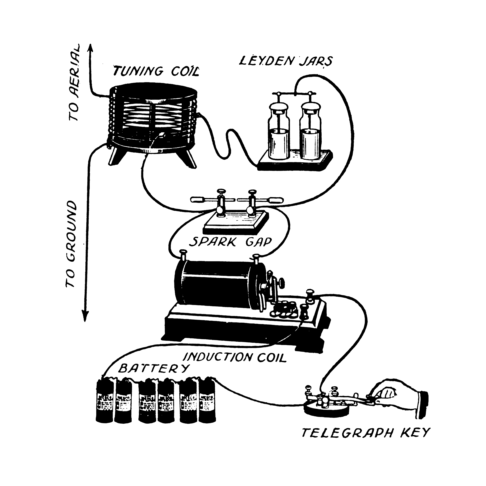

#+TITLE: timeline of the computational society
#+DESCRIPTION: html exported from org file
#+TUTORIAL: https://www.youtube.com/watch?v=LS0JMOdQw-s&t=254s https://www.theodinproject.com/
#+AUTHOR: Muyang Lyu
#+EXPORT_FILE_NAME: 
#+LANGUAGE: en
#+OPTIONS: num:nil toc:t tex:t
#+HTML_MATHJAX: align: left indent: 5em tagside: left
* Timeline
- *1887-end of WWI* Spark-gap radio transmitter
#+CAPTION: [[https://commons.wikimedia.org/w/index.php?curid=112323150][By Ernest Thompson]]
#+ATTR_HTML: :width 300

- “cat’s-whisker” detectors
- vacuum-tube electronics

- *1950-* “solid-state” electronics
- discrete transistors
- integrated circuits (ICs)
- VLSI (very large-scale integration) chips

* References
